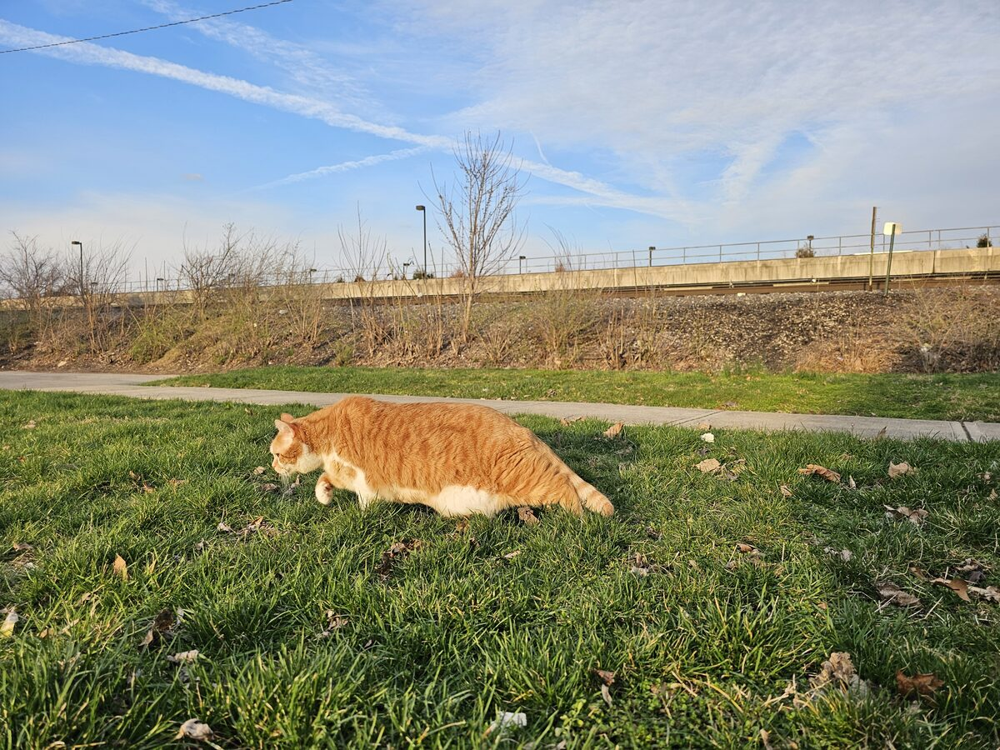
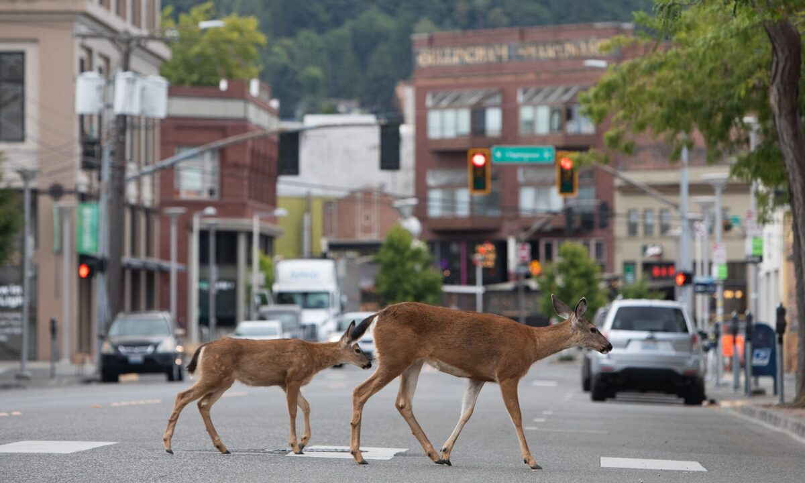

::: callout-tip
## Start fresh
Restart R before you begin (RStudio: **Session > Restart R**), then run the setup chunk below.
:::

```{r}
#| label: setup
#| eval: true
source("00_setup.R")
```

This block runs the full `multiScaleR` workflow on one covariate, the PCA urbanization index, for three species that tell three different stories. Domestic cats respond to urbanization close to the camera. Eastern chipmunks show what an uninformative result looks like, and why reporting one is still a result. White-tailed deer respond across a broad landscape.

Every analysis follows the same four steps:

1. `kernel_prep()` extracts the raster cells around each camera and records their distances.
2. You fit an ordinary model (here a negative binomial GLM) to the kernel-weighted covariate.
3. `multiScale_optim()` estimates sigma and the regression coefficients together.
4. `summary()`, `profile_sigma()`, and the plot functions tell you whether to believe the answer.

# Domestic cat: the full workflow {#sec-cat}

{width="45%" fig-align="center"}

Domestic cats in natural areas are tied to nearby homes, so we expect a positive response to urbanization at a small scale.

## Step 1: prepare kernel inputs

```{r}
#| label: cat-prep
ki_cat <- kernel_prep(
  pts = cam_sf,
  raster_stack = urb,
  max_D = 1000,
  kernel = "gaussian",
  store_cell_data = FALSE,
  verbose = FALSE
)
ki_cat
```

**How to read the `kernel_prep()` output:** the object holds 207 observations and one covariate, `urb_pca`, named after the raster layer. `Minimum Distance` (30 m, one cell) and `Maximum Distance` (`max_D`) bound the values sigma can take. `Distance binning` means each camera's cells were summarized into 256 distance bins, which makes optimization fast. `lean mode` means the individual cells were discarded after binning, so the object is about 1 MB instead of 12 MB.

::: callout-tip
## Choosing `max_D`

Set `max_D` to a distance you are confident exceeds the true scale of effect; two to three times the largest plausible sigma is a good rule. If the estimate lands near `max_D`, `multiScale_optim()` warns you and suggests a larger value. The tradeoff is memory and extraction time: a buffer of radius `max_D` holds about pi `max_D`^2^ / 900 cells per camera at 30 m resolution, so doubling `max_D` quadruples the cells.
:::

::: callout-note
## Lean mode

`store_cell_data = FALSE` keeps only the distance-binned summaries, which are all that kernel-weighted means need to optimize, profile, and project. Leave it at the default (`TRUE`) when a model will include landscape or surface metrics (Block 3); those need every cell.
:::

## Step 2: fit a starting model

```{r}
#| label: cat-model
dat_cat <- data.frame(
  visits  = site_data$cat,
  n_weeks = site_data$n_weeks,
  ki_cat$kernel_dat
)
head(dat_cat)

mod_cat <- glm.nb(visits ~ urb_pca + offset(log(n_weeks)), data = dat_cat)
```

**How to read `dat_cat`:** `kernel_dat` holds the kernel-weighted urbanization at each camera for a provisional sigma (half of `max_D`), centered and scaled to unit variance. Its column carries the raster layer's name, which is the name you use in the model formula. Because the covariate is standardized, each coefficient describes the effect of a one standard deviation (SD) change.

::: callout-warning
## Write the formula inside the model call

`multiScale_optim()` refits your model many times with new covariate values, so it needs a model call it can re-evaluate. Write the formula directly in `glm.nb()`, as above. A formula stored in a variable and built inside a loop or function (`glm.nb(f, data = dat)`) may not be found when the model is refit.
:::

## Step 3: optimize sigma

```{r}
#| label: cat-optim
system.time(
  opt_cat <- multiScale_optim(fitted_mod = mod_cat, kernel_inputs = ki_cat)
)
```

Optimization takes about a second. Earlier versions needed parallel workers (`n_cores`, `PSOCK`) and precomputed results for this step; with distance binning, a single core is faster for problems this size because starting a cluster costs more than the optimization itself.

## Step 4: examine the results

```{r}
#| label: cat-summary
summary(opt_cat)
```

**How to read the `summary()` output:** the first table is the estimated sigma for `urb_pca`, in meters, with its standard error and 95% confidence interval; the lower limit is truncated at 30 m, the smallest distance the raster resolves. The distance section converts sigma to meters two ways (Block 1): the 1D table gives the distance at which the kernel's cumulative density along a line reaches 90% (about 94 m), and the 2D table gives the radius of the circle around the camera that holds 90% of the weight of the ideal, untruncated kernel (about 123 m). Version 0.7.2 prints the 1D table first; from 0.7.4 the 2D table comes first and is marked as selected (see the note in Block 1), and the numbers do not change. The 2D radius is the one to use in a sentence: 90% of the kernel weight behind the cat estimate falls within about 120 m of the camera. Both distances describe the ideal kernel. Here `max_D` (1 km) sits far beyond them, so cutting the kernel off at `max_D` changes nothing; if the 2D radius approaches `max_D`, increase `max_D` and refit. The fitted-model section is the ordinary `glm.nb()` summary, refit at the optimized sigma. Its coefficients are on the log scale, so exponentiate them to read them as multiplicative effects:

```{r}
#| label: cat-exp
exp(coef(opt_cat$opt_mod))
```

Each one SD increase in kernel-weighted urbanization multiplies expected cat visits by about 2.3. The intercept, `exp(-2.03)` or about 0.13, is the expected number of visits per week at average urbanization; the offset puts the response on a per-week scale.

```{r}
#| label: fig-cat-kernel
#| fig-cap: "The optimized kernel for domestic cat. Weight falls to near zero within about 150 m of the camera."
plot(opt_cat)
```

### The sigma profile

`profile_sigma()` refits the model across a grid of sigma values while holding everything else at its best value. It is the most important diagnostic in the package: it shows whether the optimum is a clear valley or a flat plain.

```{r}
#| label: fig-cat-profile
#| fig-cap: "AICc across sigma for domestic cat. A single clear minimum near 57 m means the data define the scale well."
prof_cat <- profile_sigma(opt_cat, n_pts = 15)
plot(prof_cat)
```

**How to read this plot:** each point is the AICc of the model refit at that sigma. A sharp valley means the scale is well identified. A flat line means many scales fit about equally well, and a minimum at either edge means the optimum may lie outside the range you searched.

```{r}
#| label: fig-cat-marginal
#| fig-cap: "Predicted cat visits for a camera with the average 11.8 weeks of effort, across the observed range of kernel-weighted urbanization (original PCA units), with a 95% confidence band."
plot_marginal_effects(opt_cat)
```

**How to read this plot:** the x-axis is kernel-weighted urbanization back on the PCA scale, and the y-axis is predicted visits over a season of average effort, because `plot_marginal_effects()` holds `n_weeks` at its mean. Cats go from almost never detected in forest to more than 30 visits a season where the surroundings are most developed.

```{r}
#| label: cat-diagnostics
diagnostics(opt_cat)$max_distance$triggered   # FALSE: sigma is well inside max_D
diagnostics(opt_cat)$sample_size$fitted_n     # all 207 cameras used
```

::: callout-note
## Interpreting the cat result

Cats respond to urbanization within about 57 m of the camera (95% CI 30 to 96 m), and visits rise steeply with urbanization. That is the scale of a backyard and the woodland edge behind it, consistent with cats that roam out from nearby homes. Moll et al. (2020) estimated a scale of maximal effect of 84 m (95% CI 53 to 124 m) for cat visit frequency; for a Gaussian kernel their scale of maximal effect is the same quantity as sigma, so the two analyses agree well.
:::

# Eastern chipmunk: when the data cannot place a scale {#sec-chipmunk}

{width="40%" fig-align="center"}

Chipmunks are small, forest-dwelling rodents with small home ranges, so we might expect a local response to urbanization.

```{r}
#| label: chip-optim
ki_chip <- kernel_prep(cam_sf, urb, max_D = 1700, kernel = "gaussian",
                       store_cell_data = FALSE, verbose = FALSE)
dat_chip <- data.frame(visits = site_data$chipmunk, n_weeks = site_data$n_weeks,
                       ki_chip$kernel_dat)
mod_chip <- glm.nb(visits ~ urb_pca + offset(log(n_weeks)), data = dat_chip)

opt_chip <- multiScale_optim(mod_chip, ki_chip)
summary(opt_chip)
```

**How to read these warnings:** sigma landed on `max_D` (1700 m), and its standard error is several times the estimate. The optimizer started at half of `max_D`, found the likelihood nearly flat, and drifted to the boundary. The coefficient is small and not significant. Before you conclude anything, look at the profile.

```{r}
#| label: fig-chip-profile
#| fig-cap: "AICc across sigma for eastern chipmunk. The lowest values sit at the smallest scales, and the rest of the curve is nearly flat."
plot(profile_sigma(opt_chip, n_pts = 15))
```

The lowest AICc sits at the smallest sigma, the curve rises, then flattens. An optimizer that starts on the plateau cannot see the low point. Screened starts address exactly this: `start_strategy = "screen"` tries a range of log-spaced sigma values with short runs, then optimizes fully from the best one.

```{r}
#| label: chip-screen
opt_chip_screen <- multiScale_optim(mod_chip, ki_chip, start_strategy = "screen")
summary(opt_chip_screen)$opt_scale
coef(summary(opt_chip_screen$opt_mod))
```

Screening lands on the lower boundary, 30 m, with a negative effect of borderline significance (p = 0.05). (You can also pick a start yourself with `par`, on the scale of `max_D`: `par = 50 / 1700` starts at 50 m.) Neither run found an interior minimum, so the next question is whether we simply did not look far enough.

Extend `max_D` to 8 km. That window holds about 220,000 cells per camera, 46 million across the 207 cameras. Lean mode keeps only distance-binned summaries once preparation finishes, so the fitted object stays small, but the extraction itself needs about 2 GB of free memory while it runs.

```{r}
#| label: chip-8km
ki_chip8 <- kernel_prep(cam_sf, urb, max_D = 8000, kernel = "gaussian",
                        store_cell_data = FALSE, verbose = FALSE)     # about 30 s
dat_chip8 <- data.frame(visits = site_data$chipmunk, n_weeks = site_data$n_weeks,
                        ki_chip8$kernel_dat)
mod_chip8 <- glm.nb(visits ~ urb_pca + offset(log(n_weeks)), data = dat_chip8)
opt_chip8 <- multiScale_optim(mod_chip8, ki_chip8, start_strategy = "screen")

prof_chip8 <- profile_sigma(opt_chip8, n_pts = 12)
diff(range(prof_chip8$profiles$AICc))   # AICc range from 30 m to 8 km
```

```{r}
#| label: fig-chip8-profile
#| fig-cap: "AICc across sigma from 30 m to 8 km for eastern chipmunk. The whole range spans fewer than 3 AICc units."
plot(prof_chip8)
```

::: callout-important
## What the chipmunk tells us

Across a 250-fold range of sigma, from 30 m to 8 km, AICc changes by fewer than 3 units. The data cannot distinguish a backyard-scale response from a landscape-scale one, and the urbanization effect is weak at every scale. Moll et al. (2020) reached the same place with a different model: their scale of maximal effect for chipmunk visits was 6.5 km with a 95% credible interval of 2.6 to 9.8 km.

Three lessons follow. Always look at the profile before you trust a sigma. When an estimate lands on a boundary, try screened starts and a larger `max_D` before interpreting it. And when the profile is flat, report that the scale is not identifiable with these data; it is a finding, and it tells you to look for a different covariate or response.
:::

# White-tailed deer: a landscape-scale response {#sec-deer}

{width="45%" fig-align="center"}

Deer are large and mobile, and suburban edges often support high densities, so we expect a positive response at a broad scale.

```{r}
#| label: deer-optim
ki_deer <- kernel_prep(cam_sf, urb, max_D = 3000, kernel = "gaussian",
                       store_cell_data = FALSE, verbose = FALSE)
dat_deer <- data.frame(visits = site_data$deer, n_weeks = site_data$n_weeks,
                       ki_deer$kernel_dat)
mod_deer <- glm.nb(visits ~ urb_pca + offset(log(n_weeks)), data = dat_deer)
opt_deer <- multiScale_optim(mod_deer, ki_deer)
summary(opt_deer)
```

**How to read this output:** sigma is about 750 m, more than ten times the cat estimate, and the effect of urbanization is positive and strong. The standard error is large relative to sigma, which is common for landscape-scale estimates: many broad kernels produce similar smoothed values, so the likelihood is shallower. Moll et al. (2020) estimated 651 m (95% CI 482 to 879 m).

```{r}
#| label: fig-deer-profile
#| fig-cap: "AICc across sigma for white-tailed deer: a broad but clear valley."
plot(profile_sigma(opt_deer, n_pts = 15))
```

# Three species side by side {#sec-compare}

```{r}
#| label: three-species
fits <- list(cat = opt_cat, chipmunk = opt_chip_screen, deer = opt_deer)
moll_scale_max <- c(cat = 84, chipmunk = 6514, deer = 651)   # Moll et al. 2020, summer visits

data.frame(
  sigma_m       = sapply(fits, function(f) round(summary(f)$opt_scale$Mean)),
  radius_90_m   = sapply(fits, function(f) round(summary(f)$opt_dist_2d$Mean)),
  beta_per_SD   = sapply(fits, function(f) round(coef(f$opt_mod)[2], 2)),
  multiplier    = sapply(fits, function(f) round(exp(coef(f$opt_mod)[2]), 2)),
  moll_scale_m  = moll_scale_max
)
```

**How to read this table:** `sigma_m` is the estimated scale, `radius_90_m` is the 2D distance from `summary()`, the radius of the circle holding 90% of the kernel weight, `beta_per_SD` is the coefficient on the log scale, and `multiplier` is its exponent, the factor by which visits change per SD of urbanization. The chipmunk row reports the screened fit, which sits on the 30 m boundary and should not be read as an estimate. `moll_scale_m` is Moll et al.'s posterior mean scale of maximal effect, which is directly comparable to sigma.

::: callout-note
## Discussion (3 minutes)

Suppose you had measured urbanization in a single 500 m buffer around every camera, as many studies do. What would you have concluded about cats, chipmunks, and deer? Which conclusion would have been most wrong?
:::

# Save a checkpoint {#sec-checkpoint}

```{r}
#| label: checkpoint
save_checkpoint("block2", opt_cat, opt_chip_screen, opt_deer)
```

Block 3 loads these three fitted objects if they are not already in your session.

# Quick reference {#sec-quickref}

```r
## 1. Extract cells around each camera (lean mode for kernel means)
ki  <- kernel_prep(cam_sf, urb, max_D = 1000, kernel = "gaussian",
                   store_cell_data = FALSE)

## 2. Fit a starting model; formula written inside the call; effort offset
dat <- data.frame(visits = site_data$cat, n_weeks = site_data$n_weeks, ki$kernel_dat)
mod <- glm.nb(visits ~ urb_pca + offset(log(n_weeks)), data = dat)

## 3. Optimize sigma (screened starts protect against flat regions)
opt <- multiScale_optim(mod, ki, start_strategy = "screen")

## 4. Interpret and diagnose
summary(opt)                      # sigma (m), CI, 1D and 2D distances, model
exp(coef(opt$opt_mod))            # multiplicative effect per SD
plot(profile_sigma(opt, n_pts = 15))   # clear valley, flat plain, or boundary?
plot_marginal_effects(opt)        # predicted visits (average effort) across the covariate
diagnostics(opt)                  # max_D and sample-size checks
```

| Function | Purpose |
|----------|---------|
| `kernel_prep()` | Extract cells within `max_D` of each point and set up optimization |
| `multiScale_optim()` | Estimate sigma and the model coefficients together |
| `summary()` | Sigma, confidence interval, 1D and 2D distances, and the refit model |
| `profile_sigma()` | Model fit across a grid of sigma values |
| `plot_marginal_effects()` | Predicted response across the covariate range |
| `diagnostics()` | Structured warnings about `max_D`, precision, and sample size |

**Next:** `03_landscape_pattern.qmd`. See also `vignette("multiScaleR_Guide", package = "multiScaleR")`, especially the sections on starting values and model selection.

# References {.unnumbered}

Moll, R. J., J. D. Cepek, P. D. Lorch, P. M. Dennis, T. Robison, and R. A. Montgomery. 2020. At what spatial scale(s) do mammals respond to urbanization? *Ecography* 43:171-183. <https://doi.org/10.1111/ecog.04762>
